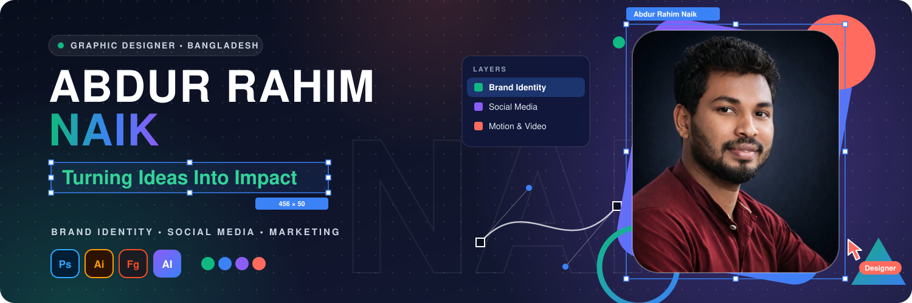

# Turning Ideas Into Impact

**Graphic Designer · Brand Identity & Social Media Designer · Marketing Creative Specialist**

Based in Bangladesh · 8+ years in creative design

---

## About Me

I'm **Abdur Rahim Naik (Naik)**, a graphic designer specializing in **brand identity, social media design, marketing creatives, and visual storytelling**. With 8+ years in creative design, I help brands look consistent, memorable, and ready for the places their audience actually sees them.

I'm also interested in **AI-powered creative workflows** and **digital product design**, and I enjoy exploring how technology can make the creative process faster without losing the human craft behind it.

---

## Core Services

| | |
|---|---|
| **Brand Identity & Logo Design** | **Visual Identity Systems** |
| **Social Media Campaign Design** | **Advertising Creatives** |
| **Marketing Materials** | **Print Design** |
| **AI-Assisted Creative Workflows** | |

---

## Skills & Tools

**Graphic Design**

**Creative Production**

**Technology & AI**

Badges list the tools I work with. They are not certifications or skill ratings.

---

## Featured Projects

My design work lives on Behance. Browse the full portfolio here: **[behance.net/abdurrahimnaik](https://www.behance.net/abdurrahimnaik)**

| Project | Type | Where to view |
|---|---|---|
| **Real Estate Social Media Campaign — Vol. 1** | Social media campaign design | [Behance portfolio](https://www.behance.net/abdurrahimnaik) |
| **Real Estate Social Media Campaign — Vol. 2** | Social media campaign design | [Behance portfolio](https://www.behance.net/abdurrahimnaik) |
| **FIFA-inspired Football Medal Design Concept** | Concept design | [Behance portfolio](https://www.behance.net/abdurrahimnaik) |
| **YouTube channel** | Video & motion content | [@abdurrahimnaik](https://www.youtube.com/@abdurrahimnaik) |
| **Instagram** | Social presence | [@abdurrahimnaik](https://www.instagram.com/abdurrahimnaik) |

<!-- TODO (owner): once you copy the exact Behance URL of each project, replace the "Behance portfolio" link in its row. -->

---

## GitHub Statistics

These cards come from free third-party services and fill in as I use GitHub. They can be slow or temporarily unavailable.

---

## Contribution Graph

My real contribution graph appears automatically further down on my GitHub profile page.

---

## Let's Connect

---

<i>Design with purpose. Create with impact.</i>

